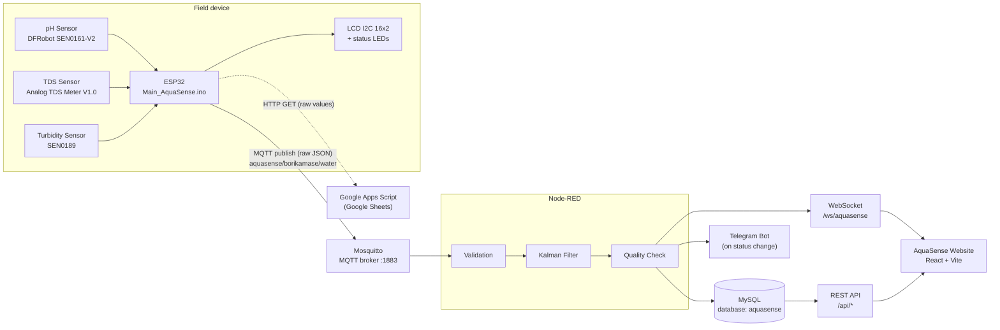
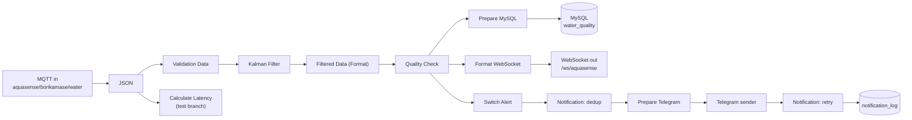

# AquaSense-Borikamase

**Real-Time IoT Water Quality Monitoring with a Kalman Filter — Desa Borikamase, Maros Baru**

This repository holds the source code for the undergraduate thesis:

> **"Implementasi Algoritma Kalman Filter pada Sistem Monitoring Kualitas Air Secara Real-Time Berbasis Internet of Things Menggunakan Node-RED (Studi Kasus: Desa Borikamase, Maros Baru)"**
>
> *(Implementation of the Kalman Filter Algorithm in a Real-Time IoT Water Quality Monitoring System Using Node-RED — Case Study: Desa Borikamase, Maros Baru)*

---

## Table of Contents

1. [System Overview](#1-system-overview)
2. [System Architecture](#2-system-architecture)
3. [Repository Structure](#3-repository-structure)
4. [Technology Stack](#4-technology-stack)
5. [ESP32 Sensor Node](#5-esp32-sensor-node)
6. [Node-RED Backend](#6-node-red-backend)
7. [Website (AquaSense Dashboard)](#7-website-aquasense-dashboard)
8. [Installation and Running the System](#8-installation-and-running-the-system)
9. [Credentials and Security](#9-credentials-and-security)
10. [Important Notes](#10-important-notes)

---

## 1. System Overview

AquaSense-Borikamase is an Internet of Things (IoT) system that monitors well water quality in Desa Borikamase in real time. It measures three parameters:

| Parameter | Unit | Description |
|---|---|---|
| pH | — | Acidity / alkalinity of the water |
| TDS (Total Dissolved Solids) | ppm | Concentration of dissolved solids |
| Turbidity | NTU | Cloudiness of the water |

The system has three parts:

| Part | Role |
|---|---|
| **ESP32 sensor node** | Reads the sensors every 60 seconds and publishes the raw values over MQTT. Also shows them on a 16x2 LCD and status LEDs. |
| **Node-RED backend** | Receives the MQTT data, validates it, applies the **Kalman Filter**, classifies water quality (**GOOD / WARNING / DANGER**), stores the result in MySQL, sends Telegram notifications, and serves a REST API and WebSocket for the website. |
| **Website** | A React dashboard that shows the data to the public (no login) and to administrators (with login). |

Goals of the system:

1. Provide real-time water quality monitoring for Desa Borikamase that the public can view without logging in.
2. Use a Kalman Filter to produce more stable sensor readings.
3. Show raw and filtered data side by side, along with an evaluation of the Kalman Filter's performance.
4. Store the measurement history so it can be browsed and exported.
5. Notify administrators through Telegram when the water quality status changes.

---

## 2. System Architecture



**Data flow from sensor to website:**

1. The **ESP32** reads pH, TDS and turbidity every 60 seconds and calculates a sensor status and a basic water quality category.
2. The ESP32 publishes the raw values as JSON to the MQTT topic `aquasense/borikamase/water`. It also sends the raw values to Google Sheets through a Google Apps Script URL.
3. **Node-RED** subscribes to the topic, validates the reading, and applies a Kalman Filter to each parameter.
4. Node-RED **classifies the water quality again**, this time using the **filtered** values. This classification is the one that is stored and shown on the website.
5. Each processed reading is **saved to MySQL** (raw and filtered values), **pushed to all website clients over WebSocket**, and checked for a **Telegram notification**.
6. The **website** gets live readings from the WebSocket and history, statistics and admin data from the REST API. The website does **not** filter or classify data itself. All raw values, filtered values and quality statuses come from Node-RED.

---

## 3. Repository Structure

```text
aquasense-borikamase/
├── README.md
├── .gitignore
├── ESP32/
│   ├── Main_AquaSense/
│   │   └── Main_AquaSense.ino        ← main ESP32 firmware
│   └── Sensor_Testing/
│       ├── PH_Sensor_Test.ino        ← pH sensor test program
│       ├── TDS_Sensor_Test.ino       ← TDS sensor test program
│       └── Turbidity_Sensor_Test.ino ← turbidity sensor test program
└── website/                          ← AquaSense website (React + Vite)
    ├── public/                       ← favicon
    ├── src/
    │   ├── components/               ← sensor cards, gauges, charts, Kalman views, layout
    │   ├── constants/                ← sensor parameters, navigation, evaluation data
    │   ├── context/                  ← MonitoringContext (WebSocket), AuthContext, ThemeContext
    │   ├── hooks/                    ← data-fetching hooks
    │   ├── layouts/                  ← public and admin layouts
    │   ├── pages/                    ← public/, admin/, Login.jsx
    │   ├── services/                 ← REST API client (api.js)
    │   ├── utils/                    ← WITA formatting, statistics, CSV/XLSX/PNG export, …
    │   ├── App.jsx                   ← routing
    │   ├── config.js                 ← API / WebSocket URL configuration
    │   ├── index.css                 ← Tailwind CSS theme and styling
    │   └── main.jsx
    ├── .env.example                  ← example configuration (no secrets)
    ├── eslint.config.js
    ├── index.html
    ├── package.json
    ├── package-lock.json
    └── vite.config.js                ← Vite configuration and proxy to Node-RED
```

> The Node-RED flow export is not in the repository yet. The [Node-RED Backend](#6-node-red-backend) section describes the flow as currently deployed.

---

## 4. Technology Stack

| Layer | Technology |
|---|---|
| Microcontroller | ESP32 (Arduino framework, Arduino IDE) |
| ESP32 libraries | `WiFi`, `HTTPClient`, `Wire`, `esp_sntp` (ESP32 core), `LiquidCrystal_I2C`, `PubSubClient` |
| Messaging | MQTT (Mosquitto broker, port 1883) |
| Backend | Node-RED |
| Node-RED add-on nodes | `node-red-node-mysql`, `node-red-contrib-telegrambot`, `node-red-dashboard` |
| Database | MySQL (database `aquasense`, time zone `+08:00`) |
| Notifications | Telegram Bot API |
| Additional logging | Google Sheets through Google Apps Script (sent directly from the ESP32) |
| Frontend framework | React 19 |
| Build tool | Vite 8 |
| Routing | React Router 7 |
| Styling | Tailwind CSS 4 (`@tailwindcss/vite`) |
| Charts | Recharts 3 |
| Icons | lucide-react |
| Linting | ESLint 10 |

---

## 5. ESP32 Sensor Node

### 5.1 Hardware Components

| No. | Component | Model / Description |
|---|---|---|
| 1 | Microcontroller | ESP32 |
| 2 | pH Sensor | DFRobot SEN0161-V2 |
| 3 | TDS Sensor | Analog TDS Meter V1.0 |
| 4 | Turbidity Sensor | SEN0189 |
| 5 | Display | LCD I2C 16x2 |
| 6 | Status Indicator | Red LED |
| 7 | Status Indicator | White LED |

**Analog TDS Meter V1.0** is the module / product type name. It is not an identified brand.

### 5.2 Pin Configuration

| Component | ESP32 Pin | Defined in code as |
|---|---|---|
| pH Sensor | GPIO 34 | `PH_PIN` |
| TDS Sensor | GPIO 33 | `TDS_PIN` |
| Turbidity Sensor | GPIO 32 | `TURBIDITY_PIN` |
| LCD I2C | Address `0x27` | `LiquidCrystal_I2C lcd(0x27, 16, 2)` |
| Red LED | GPIO 26 | `LED_MERAH` |
| White LED | GPIO 25 | `LED_PUTIH` |

All programs use a 12-bit ADC (`analogReadResolution(12)`, range 0–4095) with `ADC_11db` attenuation and a 3.3 V reference in the conversions. The code does not set custom I2C pins, so the LCD uses the default I2C (`Wire`) pins of the selected ESP32 board.

### 5.3 ESP32 Files

| Path | Description |
|---|---|
| `ESP32/Main_AquaSense/Main_AquaSense.ino` | Main firmware: sensor reading, LCD, LEDs, WiFi, NTP, MQTT and Google Sheets communication. |
| `ESP32/Sensor_Testing/PH_Sensor_Test.ino` | Stand-alone pH sensor test. |
| `ESP32/Sensor_Testing/TDS_Sensor_Test.ino` | Stand-alone TDS sensor test. |
| `ESP32/Sensor_Testing/Turbidity_Sensor_Test.ino` | Stand-alone turbidity sensor test. |

### 5.4 Main Program — Startup (`setup()`)

1. Starts the Serial Monitor at **9600 baud**, sets up the LED pins (both off), and starts the LCD (`AquaSense` / `Initializing...`).
2. Configures the ADC (12-bit, `ADC_11db`).
3. **Connects to WiFi** and waits until the connection succeeds. The LCD shows `Connecting WiFi`, then `WiFi Connected`, and the ESP32 IP address is printed.
4. **Synchronizes time over NTP** with `configTime(0, 0, "pool.ntp.org", "time.google.com")` (UTC). It waits up to 30 seconds for `esp_sntp_get_sync_status()` to report completion. If sync is not finished by then, the program continues and `loop()` keeps checking.
5. **Connects to the MQTT broker** (port `1883`) with client ID `ESP32-AquaSense-` plus a random hexadecimal suffix. It retries every 3 seconds until connected. No MQTT username or password is used.
6. **Calibrates the turbidity sensor**: takes 30 ADC samples and saves their average voltage as `clearVoltage`, the clear-water reference. The sensor must therefore be in **clear water** when the ESP32 starts.

### 5.5 Main Program — Loop (`loop()`)

- Keeps the MQTT connection alive and reconnects when it drops.
- Sets `ntpSynced` to `true` if NTP synchronization finishes after startup.
- Uses a non-blocking `millis()` timer with `interval = 60000` ms to run `readAndDisplay()` **every 60 seconds**. Each run reads the sensors, sets the LEDs, prints to Serial, sends to Google Sheets, publishes to MQTT, and updates the LCD.

### 5.6 Sensor Reading

| Sensor | Function | Method |
|---|---|---|
| pH | `readPH()` | 10 ADC readings 30 ms apart; sorts them and averages the middle 6. `volt = avg × 3.3 / 4095`, `pH = -5.70 × volt + calibration_value` with `calibration_value = 11.60 + 3.4`. |
| TDS | `readTDS()` | One ADC reading converted to voltage. `EC = (133.42·V³ − 255.86·V² + 857.39·V) / 1000`, temperature compensation `1 + 0.02 × (T − 25)` with a **fixed T = 25.0 °C**, `TDS = EC × 500 × 1.0` (ppm). |
| Turbidity | `readTurbidity()` | Average of 30 ADC readings 5 ms apart, converted to voltage. `NTU = (clearVoltage − voltage) × 300`, limited to 0–1000 NTU. |

The ESP32 does **not** apply a Kalman Filter. It sends unfiltered values. The Kalman Filter runs in Node-RED.

### 5.7 Sensor Status, Water Quality and LEDs (on the ESP32)

| Function | Rule |
|---|---|
| `getSensorStatus()` | `ERROR` if pH = 0 or TDS = 0, otherwise `SUCCESS`. |
| `getQuality()` | `GOOD` if 6.5 ≤ pH ≤ 8.5 **and** TDS < 300 **and** turbidity < 5. Otherwise `WARNING` if 300 ≤ TDS < 600 **or** 5 ≤ turbidity < 50. Otherwise `DANGER`. |
| `updateLED()` | White LED on (red off) when status is `SUCCESS` **and** quality is `GOOD`. Otherwise red LED on (white off). |

The LCD shows `pH:<x.x> TDS:<x>` on line 1 and `Turb:<x.x> NTU` on line 2.

> The ESP32 uses these quality results only for its LEDs, the Google Sheets log, and its MQTT message. Node-RED ignores the `water_quality` value sent by the ESP32 and classifies the reading again from the Kalman-filtered values (see [6.3](#63-processing-pipeline-aquasense-tab)).

### 5.8 Outgoing Data

**MQTT** — topic `aquasense/borikamase/water`:

```json
{
  "ph": 7.12,
  "tds": 245,
  "turbidity": 3.40,
  "sensor_status": "SUCCESS",
  "water_quality": "GOOD",
  "timestamp_sent": 1762675200000
}
```

*(Example values.)* `ph` and `turbidity` have 2 decimals and `tds` has 0. `timestamp_sent` is the Unix time in milliseconds. It is included only when NTP is synchronized and the clock is later than 1 January 2024 UTC.

**Google Sheets (HTTP GET):**

```text
<serverName>?ph=<pH>&tds=<TDS>&turb=<NTU>&sensor=<sensor_status>&quality=<water_quality>
```

### 5.9 Sensor Test Programs

The programs in `ESP32/Sensor_Testing/` are **separate from the main firmware**. Each one tests a single sensor through the Serial Monitor only, with no WiFi, MQTT, NTP, LCD or LEDs. Each uses the same pin and reading formula as the main program.

| Program | Sensor / Pin | Samples | Special step |
|---|---|---|---|
| `PH_Sensor_Test.ino` | DFRobot SEN0161-V2, GPIO 34 | 5 | — |
| `TDS_Sensor_Test.ino` | Analog TDS Meter V1.0, GPIO 33 | 3 | — |
| `Turbidity_Sensor_Test.ino` | SEN0189, GPIO 32 | 3 | Clear-water calibration at startup (asks you to press ENTER, then prints `Clear Voltage`) |

All three programs work the same way:

1. For each sample, the program asks you to put the sensor in the sample and press **ENTER** once the reading is stable.
2. It then takes **10 measurements** 500 ms apart, prints each one, and prints the average.
3. After the last sample it prints `SELURUH PENGUJIAN SELESAI.` ("all tests completed") and stops.

---

## 6. Node-RED Backend

### 6.1 Overview

The Node-RED flow has two tabs:

| Tab | Content |
|---|---|
| **Aquasense** | MQTT input, validation, Kalman Filter, quality check, MySQL storage, WebSocket output, Telegram notifications, runtime trackers, a latency test branch, the legacy `/api/water/latest` and `/api/water/history` endpoints, and a manual historical replay. |
| **AquaSense API** | Startup configuration and database setup, an authentication guard, and the public and admin REST API used by the website. |

### 6.2 System Configuration

At startup the node **"Set AquaSense config"** stores the deployment settings in Node-RED global context. These values contain no secrets and are exposed to the website through `GET /api/config`:

| Setting | Value |
|---|---|
| Device ID | `AM-BORIKAMASE-01` |
| Location | Desa Borikamase, Maros Baru |
| Time zone | `Asia/Makassar` (WITA, UTC+08:00) |
| Sampling interval | 60 s |
| Freshness threshold | 180 s (after this a reading is stale, which is 3 missed samples) |
| MQTT topic | `aquasense/borikamase/water` |
| Monitoring sessions (WITA) | Pagi 08:00–11:00, Siang 13:00–16:00, Sore 16:00–19:00. Readings outside these windows are labelled "Di luar sesi". |
| Telegram cooldown | 300 s |
| Admin authentication | Session lifetime 12 h, lockout after 5 failed logins for 10 min, minimum password length 8 |
| History limits | Max page size 200, export limit 100,000 rows |

### 6.3 Processing Pipeline (Aquasense tab)



**1. Validation Data**

The reading is dropped (with a warning in Node-RED) if any of these is true:

- The payload is not an object.
- `ph`, `tds` or `turbidity` is missing.
- Any value is not a finite number.
- pH is outside 0–14.
- TDS or turbidity is negative.

Valid readings are rebuilt as:

```text
device_id      = "AM-BORIKAMASE-01"
timestamp      = reception time in WITA (ISO 8601, +08:00)
ph_raw, tds_raw, turbidity_raw
sensor_status  = value from the ESP32 (or "UNKNOWN" if missing)
```

**2. Kalman Filter**

A one-dimensional Kalman Filter is applied separately to each parameter. Its state is kept in the node's context.

| Parameter | Process noise **Q** | Measurement noise **R** |
|---|---|---|
| pH | 0.01 | 0.1 |
| TDS | 10 | 20 |
| Turbidity | 0.1 | 1 |

- Initial estimate: the first measurement received. Initial error covariance: `P = 1`.
- For each new reading:
  - Prediction: `P = P + Q`
  - Gain: `K = P / (P + R)`
  - Update: `x = x + K·(z − x)`, then `P = (1 − K)·P`
- Results are rounded to 2 decimals as `ph_filtered`, `tds_filtered` and `turbidity_filtered`.

**3. Quality Check** — uses the **filtered** values:

| Order | Condition | Result |
|---|---|---|
| 1 | 6.5 ≤ pH ≤ 8.5 **and** TDS < 300 ppm **and** turbidity < 5 NTU | `GOOD` |
| 2 | 300 ≤ TDS < 600 ppm **or** 5 ≤ turbidity < 50 NTU | `WARNING` |
| 3 | Any other case | `DANGER` |

**4. Outputs**

- **MySQL**: inserts one row into `water_quality` with `device_id`, `timestamp` (MySQL `NOW()`, WITA), the raw and filtered values for each parameter, `sensor_status` and `water_quality`.
- **WebSocket** (`/ws/aquasense`): sends the processed reading as JSON to all connected website clients, with a `session` field (Pagi / Siang / Sore / Di luar sesi) taken from the WITA timestamp.
- **Telegram**: see [6.4](#64-telegram-notifications).

**5. Latency test branch — Calculate Latency**

This test branch is separate from the main pipeline. It compares the ESP32's `timestamp_sent` with the time Node-RED receives the message:

- It rejects messages with a missing or invalid timestamp.
- It treats differences above 1000 ms as a clock mismatch.
- It keeps running count, average, minimum and maximum latency.
- Results go to the node status and a debug output only.

**6. Runtime trackers**

These count received MQTT messages and valid readings, and track node status. The counts feed `/api/health` and `/api/admin/system`.

### 6.4 Telegram Notifications

- **Sent only when the state changes**: the first classified reading, a change in water quality (in any direction), a sensor reporting an error, or a sensor recovering from an error. Repeated identical readings never send a message.
- **Cooldown of 300 s** between notifications to prevent flapping around a threshold. A sensor error skips the cooldown, unless the previous delivery failed.
- **Message content**: status (🟢 GOOD / 🟡 WARNING / 🔴 DANGER), the reason, the filtered pH, TDS and turbidity values, a recommended action, the location ("Sumur Borikamase") and the measurement time in WITA.
- **Retry**: up to 3 attempts, with waits of 15 s and then 45 s. Every result is written to the `notification_log` table as `SENT` or `FAILED`. After a restart, the last notified state is restored from the most recent delivered log entry.
- **Test message**: `POST /api/admin/telegram/test`, available on the website's Telegram page.
- **Historical replay** (manual, through inject nodes): re-sends past status events from stored readings, 5 per run.

### 6.5 Database

- MySQL database `aquasense` on `127.0.0.1:3306`, connection time zone `+08:00`.
- `water_quality` holds the sensor readings. It must already exist. At startup the flow only adds the index `idx_water_quality_timestamp`.
- At startup the flow also creates these tables if they do not exist, retrying every 60 s while MySQL is unreachable:

| Table | Purpose |
|---|---|
| `users` | Administrator accounts |
| `user_sessions` | Login sessions |
| `notification_log` | Telegram delivery log |
| `admin_audit_log` | Audit log of admin actions |

### 6.6 Authentication

- Passwords are hashed with **scrypt** (Node.js `crypto`) and compared with `timingSafeEqual`.
- Logging in creates a server-side session, sent as an **HttpOnly** cookie. The website never stores tokens or passwords.
- Admin endpoints go through the "auth guard" link call, which returns `401` without a valid session.

### 6.7 REST API and WebSocket

**WebSocket:** `/ws/aquasense` — pushes each processed reading in real time.

**Public endpoints:**

| Method | Endpoint | Description |
|---|---|---|
| GET | `/api/health` | System and data freshness status |
| GET | `/api/config` | Public system configuration (see 6.2) |
| GET | `/api/water/latest` | Latest reading |
| GET | `/api/water/history` | Recent readings |
| GET | `/api/water/readings` | Paginated, filtered readings (`from, to, session, quality, search, page, pageSize`) |
| GET | `/api/water/summary` | Summary statistics for the same filters |
| GET | `/api/water/series` | Chart series (`range=15m\|1h\|24h\|all\|custom, from, to, max`) |
| GET | `/api/water/metrics` | Kalman Filter evaluation metrics (`from, to`) |
| POST | `/api/auth/login` | Administrator login |

**Admin endpoints (session required):**

| Method | Endpoint |
|---|---|
| GET | `/api/auth/me`, `/api/auth/session` |
| POST | `/api/auth/logout` |
| PUT | `/api/admin/profile` |
| GET / PUT / DELETE | `/api/admin/profile/photo` |
| POST | `/api/admin/password` |
| GET | `/api/admin/export`, `/api/admin/notifications`, `/api/admin/audit`, `/api/admin/system` |
| POST | `/api/admin/telegram/test` |

> The website's Telegram page also calls `POST /api/admin/notifications/:id/send` (resend) and `DELETE /api/admin/notifications/:id` (delete). These two endpoints are **not in the currently deployed Node-RED flow**, so those two actions will not work until the endpoints are added back.

---

## 7. Website (AquaSense Dashboard)

### 7.1 Features

- **Real-time monitoring** over WebSocket, with automatic reconnection. While the WebSocket is down, the website polls the latest reading every 30 s.
- **Data status indicator: LIVE / WAITING FOR DATA / OFFLINE.**
  - The website checks `/api/health` every 15 s.
  - A reading counts as LIVE while it is newer than the freshness threshold (180 s by default, or the value from `/api/config`).
  - The last known values stay visible in every state.
- **Raw vs. filtered charts** for each sensor parameter.
- **Measurement history** with filters for date range, session and quality status.
- **Measurement sessions** Pagi, Siang and Sore (the list comes from the backend).
- **WITA time zone** (Asia/Makassar, UTC+8) for all displays and filters.
- **Kalman Filter evaluation**: standard deviation and measurement fluctuation, before and after filtering.
- **Data export** to CSV and Excel (XLSX) on admin pages, and chart export to PNG.
- **Device and integration status** for ESP32, MQTT, Node-RED, MySQL, WebSocket and Telegram.
- **Admin authentication** with a server-side session (`HttpOnly` cookie).
- **Dark (default) and light theme**, saved per browser.

### 7.2 Public Pages (no login)

| Route | Page | Content |
|---|---|---|
| `/` | Monitoring | Current water quality status and LIVE / WAITING / OFFLINE indicator, pH / TDS / turbidity cards with gauges, today's reading count, real-time raw vs. filtered chart, today's quality distribution, and the threshold table |
| `/history` | History | Stored measurements with date, session and quality filters, summary statistics, and a paginated table |

### 7.3 Admin Pages (login at `/login`)

All `/admin/*` routes require a valid login session.

| Route | Page | Description |
|---|---|---|
| `/admin/dashboard` | Dashboard | Sensor summary, data reading, raw vs. filtered chart and system status |
| `/admin/monitoring` | Real-Time Monitoring | Live sensor data |
| `/admin/data-reading` | Data Reading | Sensor statistics, reading counts and quality distribution by date and session |
| `/admin/history` | Monitoring History | History with CSV / Excel export |
| `/admin/kalman` | Kalman Filter Analysis | See 7.4 |
| `/admin/integration` | System Integration | Status of ESP32, MQTT, Node-RED, MySQL, WebSocket and Telegram |
| `/admin/telegram` | Telegram Notification | Notification history and test message (resend and delete are described in the note in 6.7) |
| `/admin/settings` | Settings | System configuration information and theme setting |
| `/admin/profile` | Profile | Admin profile, profile photo and password change |

### 7.4 Kalman Filter Analysis (`/admin/kalman`)

1. **Sensor Accuracy Evaluation**: results of sensor accuracy tests against reference instruments (accuracy, MAE and RMSE). These are documented test results shown on the page. They are not recalculated from monitoring data.
2. **Filter Performance Evaluation**: calculated from stored data for the selected date range and session:
   - *Standard Deviation*: SD Raw, SD Filtered, SD Reduction.
   - *Measurement Fluctuation*: Fluctuation Raw, Fluctuation Filtered, Fluctuation Reduction.
3. **Kalman Filter Visualization**: raw vs. filtered charts for each parameter, with date / session filters and PNG export.

### 7.5 Connection to Node-RED

The website talks to Node-RED through the **Vite proxy** (`website/vite.config.js`). Requests to `/api/*` and WebSocket connections to `/ws/*` are forwarded to Node-RED. This keeps the website and API on the same origin, which the admin session cookie needs.

| Variable (`website/.env`) | Default | Description |
|---|---|---|
| `NODE_RED_URL` | `http://localhost:1880` | Node-RED address used by the Vite proxy (read only by the Vite server) |
| `VITE_API_URL` | *(empty)* | Set only when the website is **not** served through the proxy |
| `VITE_WS_URL` | *(empty)* | Set only when the website is **not** served through the proxy |

> Never put secrets in `VITE_*` variables. Their values are bundled into the browser JavaScript. The `.env` file is not included in the repository; use `.env.example` as a template.

---

## 8. Installation and Running the System

Start the parts in this order: **MQTT broker and MySQL → Node-RED → ESP32 → Website**.

### 8.1 MQTT Broker and MySQL

1. Install and start an MQTT broker (the project uses **Mosquitto**) on port `1883`, reachable from the ESP32's WiFi network.
2. Install MySQL and create the `aquasense` database with the `water_quality` table (see [6.5](#65-database)). The other tables are created by Node-RED.

### 8.2 Node-RED

1. Install Node-RED and start it (default `http://localhost:1880`).
2. Install the add-on nodes through **Manage palette**: `node-red-node-mysql`, `node-red-contrib-telegrambot` and `node-red-dashboard`.
3. Import the AquaSense flow and set the credentials in the configuration nodes:
   - MQTT broker address
   - MySQL user and password
   - Telegram bot token and chat ID
4. Click **Deploy**. On startup the flow loads its configuration and prepares the database tables.

### 8.3 ESP32

1. Install **Arduino IDE** and the **ESP32 board package** (Boards Manager). The core must provide `esp_sntp.h`.
2. Install the external libraries through **Library Manager**: `LiquidCrystal_I2C` and `PubSubClient`. The other headers (`Wire.h`, `WiFi.h`, `HTTPClient.h`, `esp_sntp.h`, `time.h`, `sys/time.h`, `Arduino.h`, `math.h`) come with the board package and toolchain.
3. Open `ESP32/Main_AquaSense/Main_AquaSense.ino`. The folder name must match the sketch name.
4. Replace the placeholders and set your broker address:

   ```cpp
   const char* ssid = "YOUR_WIFI_SSID";
   const char* password = "YOUR_WIFI_PASSWORD";
   String serverName = "YOUR_GOOGLE_SCRIPT_URL";

   const char* mqtt_server = "...";   // IP address of your MQTT broker
   const int mqtt_port = 1883;
   const char* mqtt_topic = "aquasense/borikamase/water";
   ```

   Keep the topic `aquasense/borikamase/water`. It must match the Node-RED MQTT input.

5. Wire the hardware as in [5.2](#52-pin-configuration).
6. Select your ESP32 board (**Tools → Board**) and port (**Tools → Port**), then click **Upload**. Put the turbidity sensor in clear water before the ESP32 starts.
7. Open the **Serial Monitor at 9600 baud** and check for:
   - `WiFi Connected` and the IP address
   - `NTP: SYNCHRONIZED`
   - MQTT `CONNECTED`
   - the `Kalibrasi clearVoltage` value (the turbidity calibration voltage)
   - about every 60 s: `HTTP: <code>` and `MQTT: SENT` with the JSON payload

**Running a sensor test program:**

1. Open the test `.ino` file. Arduino IDE needs each sketch in a folder with the same name, so it may offer to create one (for example `PH_Sensor_Test/`) and move the file. Accept, or copy the file into such a folder first.
2. Upload the sketch.
3. Open the Serial Monitor at **9600 baud** with line ending **Newline** (or **Both NL & CR**), and follow the prompts.

### 8.4 Website

**Requirements:** Node.js 20.19+ or 22.12+ with npm, Git, and a running AquaSense Node-RED backend. Without Node-RED, the website still opens but shows OFFLINE and no data.

```bash
git clone https://github.com/lizzamirizza-tech/aquasense-borikamase.git
cd aquasense-borikamase/website
npm install

cp .env.example .env      # Windows PowerShell: Copy-Item .env.example .env
npm run dev               # open http://localhost:5173
```

| Command | Description |
|---|---|
| `npm run dev` | Development server |
| `npm run dev -- --host` | Development server reachable from other devices on the same network |
| `npm run build` | Production build into `dist/` |
| `npm run preview` | Serve the production build (the Node-RED proxy stays active) |
| `npm run lint` | Run ESLint |

---

## 9. Credentials and Security

None of these secrets are stored in this repository:

| Secret | Where it is configured |
|---|---|
| WiFi SSID and password | `Main_AquaSense.ino` (placeholders in the repository) |
| Google Apps Script URL | `Main_AquaSense.ino` (placeholder in the repository) |
| MQTT broker credentials | Node-RED credential store |
| MySQL user and password | Node-RED credential store |
| Telegram bot token and chat ID | Node-RED |
| Administrator accounts | MySQL `users` table (passwords hashed with scrypt) |

---

## 10. Important Notes

- **Placeholders for sensitive ESP32 settings.** The `Main_AquaSense.ino` in this repository uses placeholders instead of the real values:

  | Placeholder | Replace with |
  |---|---|
  | `YOUR_WIFI_SSID` | WiFi network name |
  | `YOUR_WIFI_PASSWORD` | WiFi password |
  | `YOUR_GOOGLE_SCRIPT_URL` | Google Apps Script web app URL |

- **Fill in your own settings before running.** The firmware cannot connect to WiFi or log to Google Sheets until the placeholders are replaced. Also set `mqtt_server` to your own broker's IP address.
- **Never commit real credentials.** Do not put real WiFi passwords, Google Apps Script URLs, tokens or other secrets in this repository, its documentation, or its commit history.
- **The GitHub firmware differs from the deployed firmware.** The firmware on the device contains the real configuration values. The repository copy differs **only** in the three placeholder lines (`ssid`, `password` and `serverName`). Everything else is identical, including pins, MQTT, LCD, NTP, sensor formulas and status logic.
- **Only the published copy was changed.** The placeholders were applied only to the copy uploaded to GitHub. The original local source files were not modified.
- **Turbidity calibration happens at startup.** The ESP32 measures the clear-water reference once, when it starts.
- **TDS temperature compensation uses a fixed 25 °C**, because the system has no temperature sensor.
- **The ESP32 waits for WiFi and MQTT at startup.** It does not continue until both are connected, so check the Serial Monitor if it seems stuck.
- **The Kalman Filter state lives in Node-RED's context.** After Node-RED restarts, the filter starts again from the next measurement it receives.

---

Developed for undergraduate thesis research — AquaSense-Borikamase, Desa Borikamase, Maros Baru.
